# MCMCtreeR Bench

[English](README.md) | [中文](README.zh-CN.md)

MCMCtreeR Bench is a bilingual, light/dark-aware Shiny application for preparing
MCMCtree time priors with
[MCMCtreeR](https://github.com/PuttickMacroevolution/MCMCtreeR) and for
visualising time-calibrated phylogenies. Version **0.1.0**.

**Online application (Posit Connect Cloud):**
<https://zengzichao-mcmctreer-bench.share.connect.posit.cloud/>

MCMCtreeR Bench is an independent wrapper. It does not modify the original package and
does not replace MCMCtree or PAML.

## Screenshots

| Mode | Light | Dark |
| --- | --- | --- |
| English | 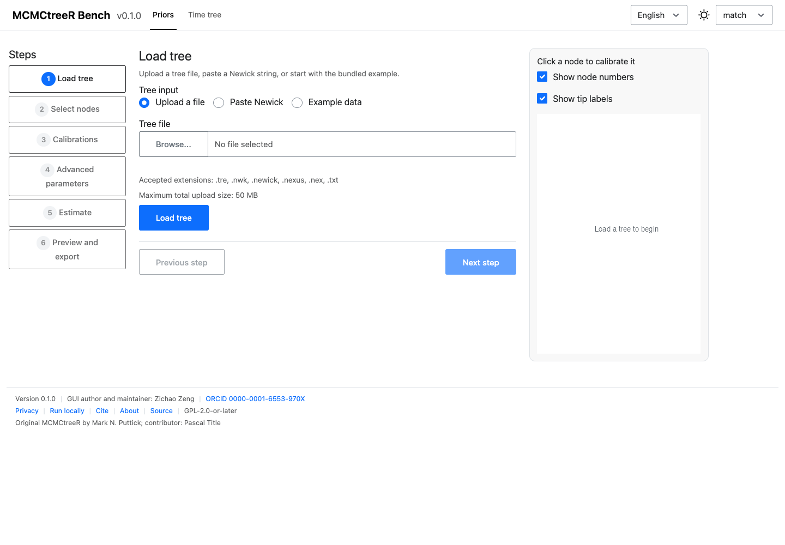 | 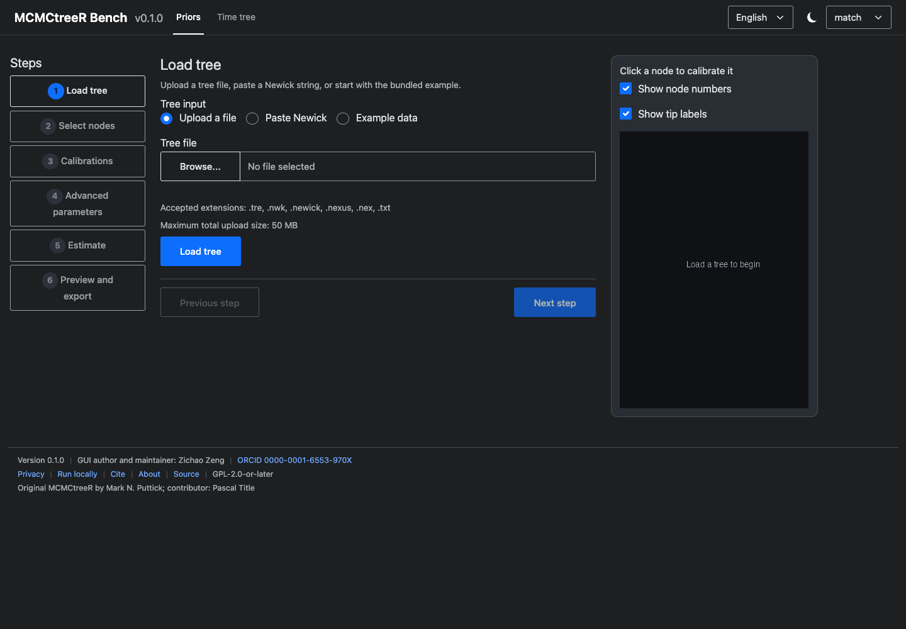 |
| 中文 |  |  |

### Calibration, time tree and export

| View | Light EN | Dark EN | Light 中文 | Dark 中文 |
| --- | --- | --- | --- | --- |
| Calibration table | 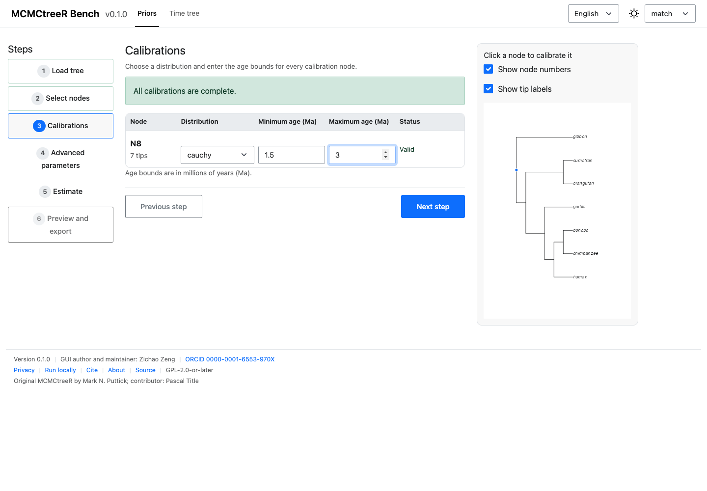 | 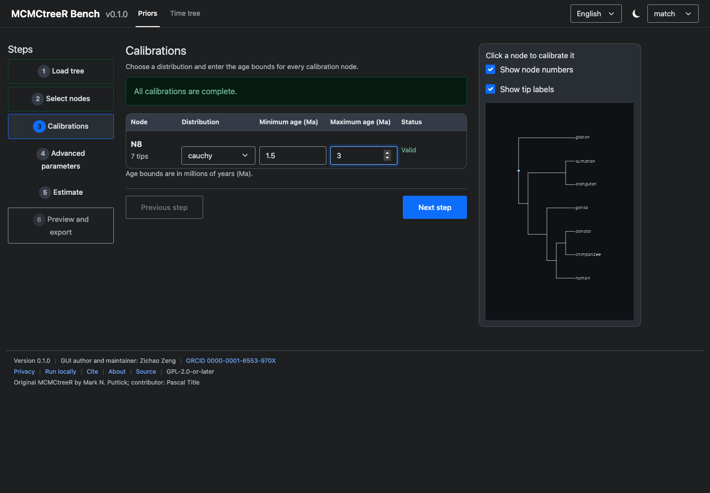 |  | 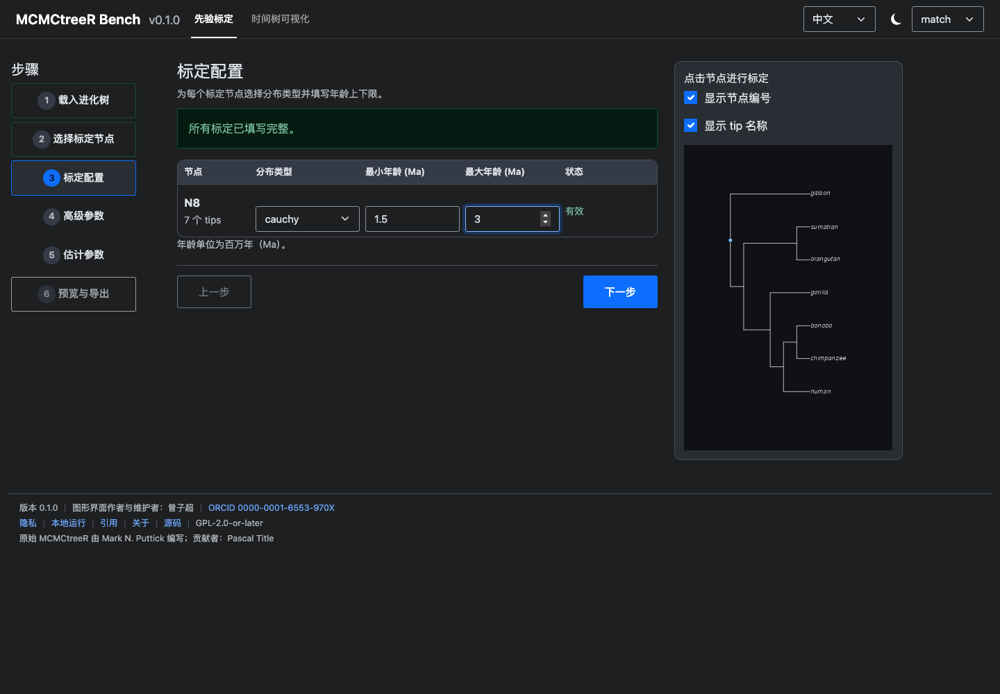 |
| Time tree | 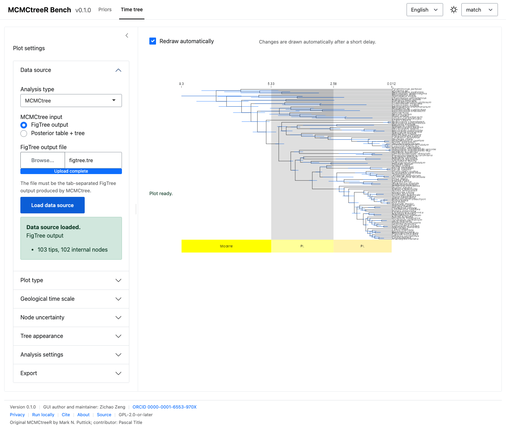 | 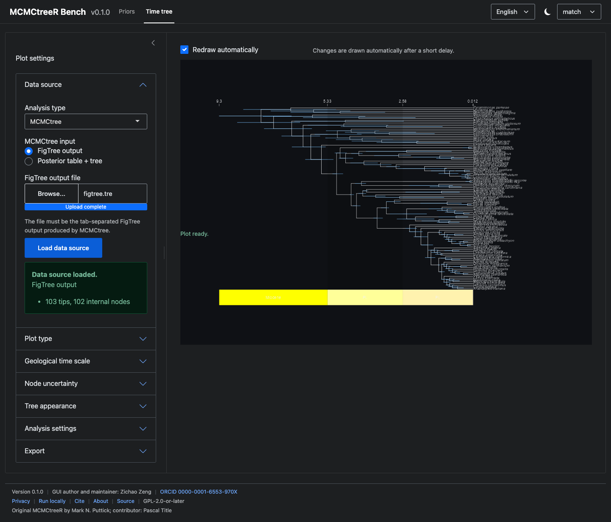 | 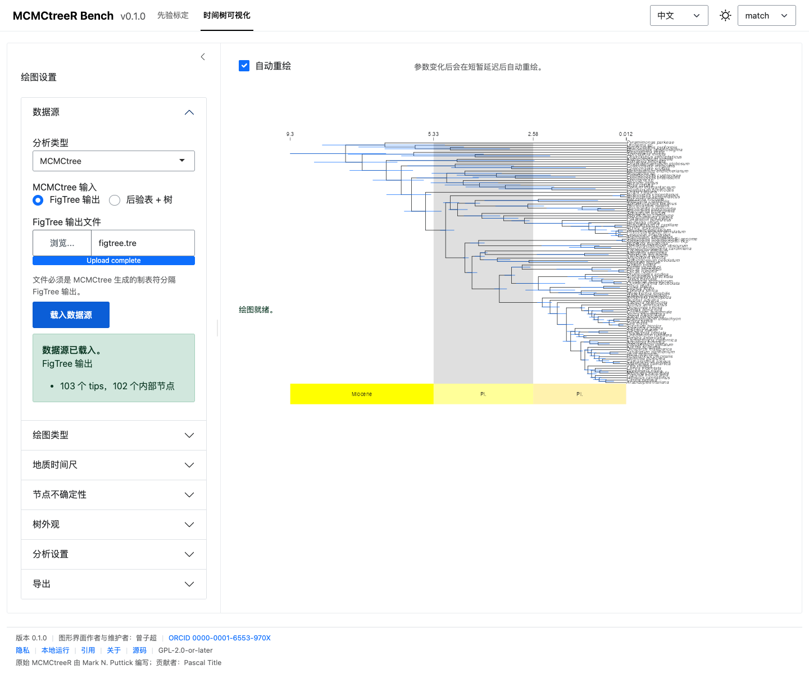 | 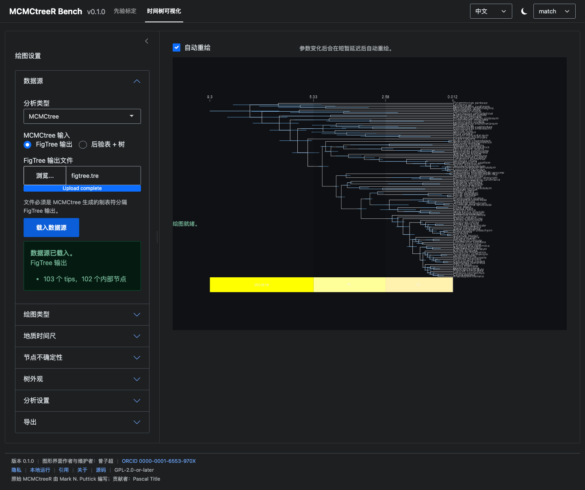 |
| Export panel | 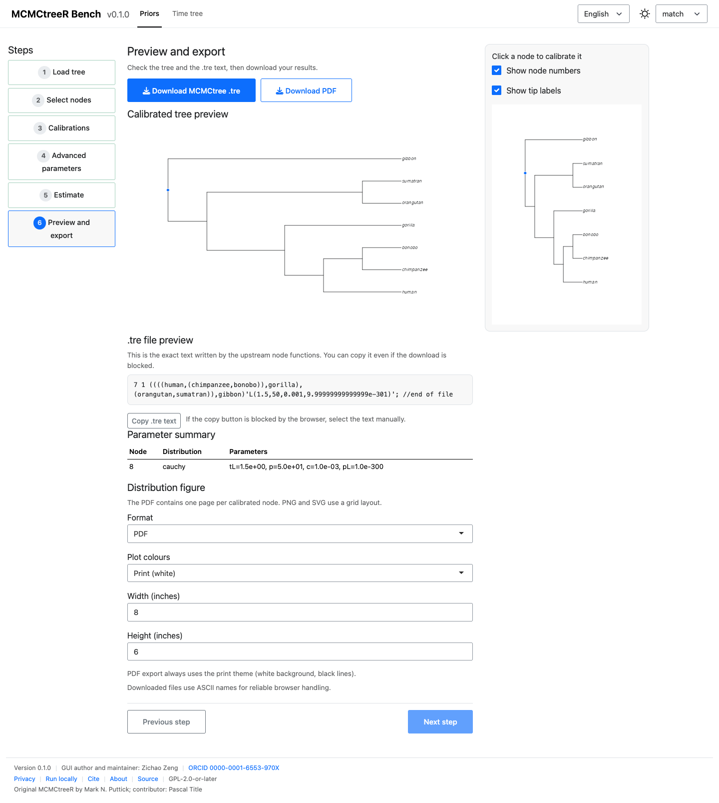 | 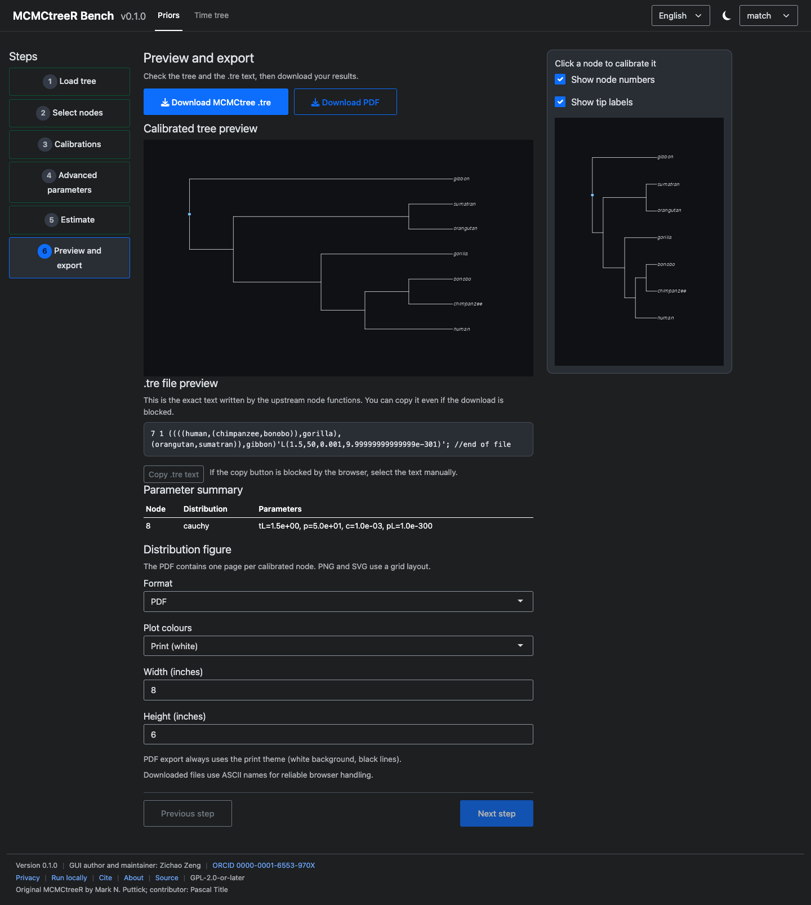 | 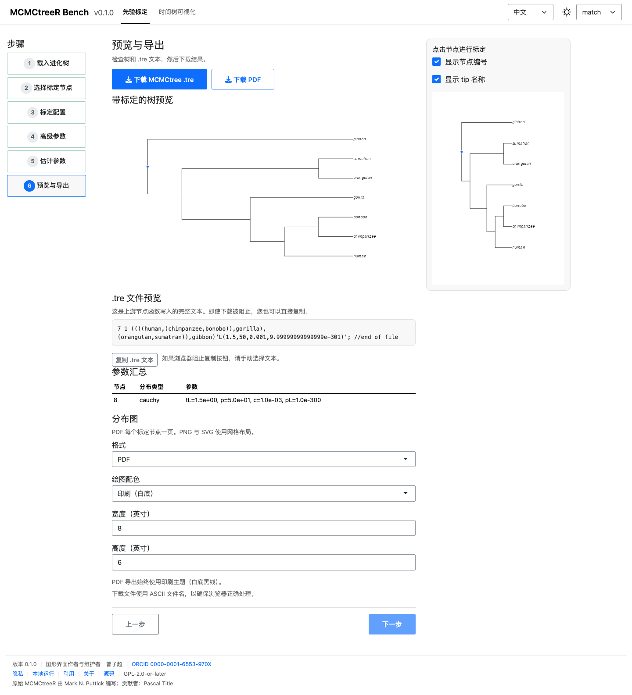 | 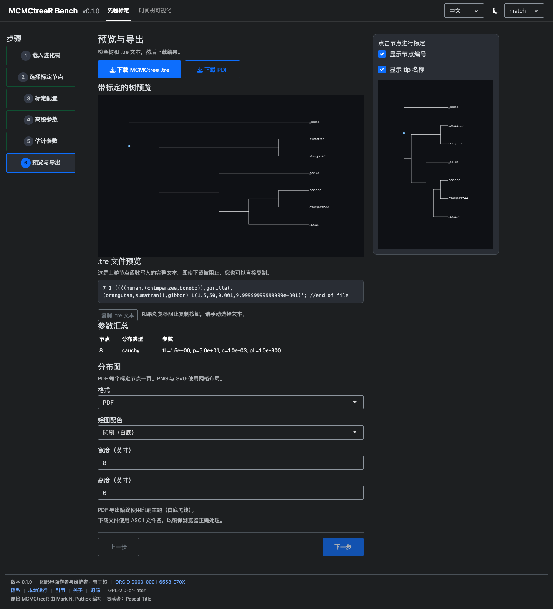 |

## What you can do

- **Prepare priors without R code.** Upload a tree, click calibration nodes,
  enter fossil age bounds, choose `cauchy`, `skewT`, `skewNormal`, `gamma`,
  `bound`, `upper` or `fixed`, and export a MCMCtree-ready `.tre` file.
- **Inspect the calibration scope.** Every selected node shows its descendant
  tips, so you can check that a fossil calibration covers the intended clade.
- **Visualise a time tree.** Import MCMCtree, MrBayes, RevBayes or User data and
  draw phylograms, cladograms or posterior distribution plots with geological
  time scales. Export PDF, PNG or SVG.

## Quick start (online)

1. Open <https://zengzichao-mcmctreer-bench.share.connect.posit.cloud/>.
2. In **Priors**, load the bundled example or your own tree.
3. Select internal nodes, complete the calibration table, run the estimation,
   and download the `.tre` file.
4. In **Time tree**, load a data source, adjust the plot settings, and download
   the figure.

Download your files before closing the page: the server does not keep results
between sessions.

## Local installation

`MCMCtreeR` is no longer on CRAN. Install the pinned upstream commit, then this
package:

```r
# 1) Upstream dependency, pinned to a reproducible commit
remotes::install_github(
  "PuttickMacroevolution/MCMCtreeR@2330e7a9916c3929513ee217d3854be993965f6b",
  build_vignettes = FALSE
)

# 2) MCMCtreeR Bench
remotes::install_github("ZengZichao/MCMCtreeR-Bench")
mcmctreer::run_app()
```

Do **not** use `install.packages("MCMCtreeR")`: the package was archived on
CRAN and that command will fail. For a source checkout, use
`devtools::load_all()` (or `pkgload::load_all()`) and `mcmctreer::run_app()`.

## Privacy

Uploaded files are sent to the Posit Connect Cloud server and are written only to
a session-specific temporary directory. That directory is deleted when the
session ends or the instance restarts. Do not upload sensitive or unpublished
data; run the application locally if you need to keep data on your own machine.
See [docs/en/about/privacy.md](docs/en/about/privacy.md).

## Licence

GPL-2.0-or-later. Copyright (C) 2026 Zichao Zeng. The original `MCMCtreeR`
package is also GPL (>= 2) and remains copyright of its original authors.

## Author and credits

GUI author and maintainer: **Zichao Zeng** (曾子超),
<zengzichao@sjtu.edu.cn>, ORCID
[0000-0001-6553-970X](https://orcid.org/0000-0001-6553-970X).

Original `MCMCtreeR` package: **Mark N. Puttick** (author and maintainer of the
original package); **Pascal Title** (contributor to the original CRAN 1.1
package). Upstream repository and commit:
<https://github.com/PuttickMacroevolution/MCMCtreeR> @
`2330e7a9916c3929513ee217d3854be993965f6b`.

MCMCtreeR Bench is an independent wrapper. The original authors are not responsible for
GUI-specific errors.

## How to cite

```bibtex
@software{zeng2026mcmctreergui,
  author  = {Zeng, Zichao},
  title   = {{MCMCtreeR Bench}},
  version = {0.1.0},
  year    = {2026},
  url     = {https://github.com/ZengZichao/MCMCtreeR-Bench},
  note    = {R package version 0.1.0}
}

@article{puttick2019mcmctreer,
  author  = {Puttick, Mark N.},
  title   = {{MCMCtreeR}: functions to prepare {MCMCtree} analyses and
             visualize posterior ages on trees},
  journal = {Bioinformatics},
  year    = {2019},
  volume  = {35},
  number  = {24},
  pages   = {5321--5322},
  doi     = {10.1093/bioinformatics/btz554}
}
```

## Documentation

- [User guide](docs/en/user-guide/quickstart.md)
- [Parameter reference](docs/en/reference/parameters.md)
- [Local deployment](docs/en/deployment/local.md)
- [Posit Connect Cloud deployment](docs/en/deployment/connect-cloud.md)
- [Architecture](docs/en/development/architecture.md)
- [FAQ](docs/en/reference/faq.md)

## Support and scope

This is an academic tool maintained on a best-effort basis, without an SLA.
Please open a GitHub issue for reproducible bugs. The application prepares
inputs and figures; it does not run MCMCtree/PAML, validate the biological
plausibility of fossil ages, or provide accounts or persistent storage.
