# MCMCtreeR Bench

[English](README.md) | [中文](README.zh-CN.md)

MCMCtreeR Bench 是基于 Shiny 的中英文双语、亮/暗主题应用，用于通过
[MCMCtreeR](https://github.com/PuttickMacroevolution/MCMCtreeR) 准备 MCMCtree
时间先验，并可视化时间标定系统发育树。版本 **0.1.0**。

**线上应用（Posit Connect Cloud）：**
<https://zengzichao-mcmctreer-bench.share.connect.posit.cloud/>

本界面是独立包装层，不修改原包，也不替代 MCMCtree 或 PAML。

## 截图

| 模式 | 亮色 | 暗色 |
| --- | --- | --- |
| English |  | 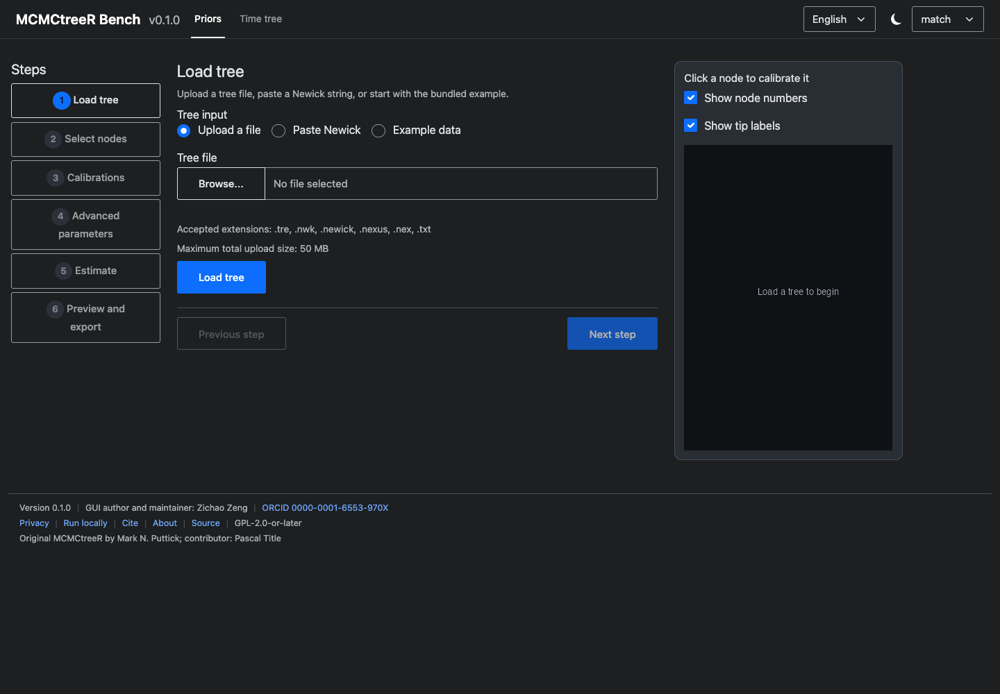 |
| 中文 |  | 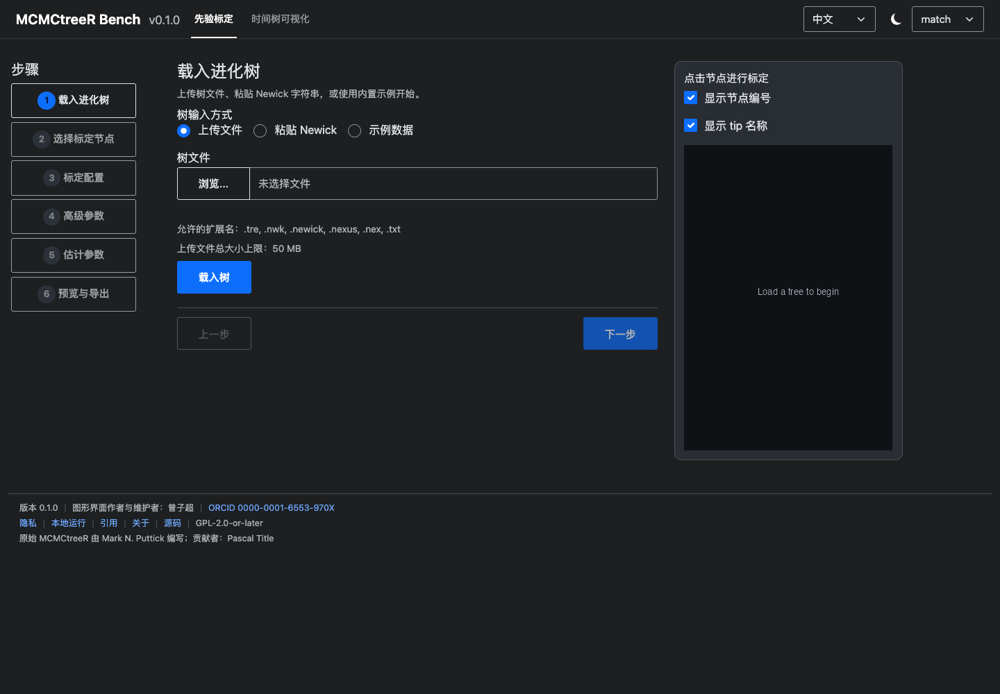 |

### 标定、时间树与导出

| 视图 | 亮色英文 | 暗色英文 | 亮色中文 | 暗色中文 |
| --- | --- | --- | --- | --- |
| 标定表 | 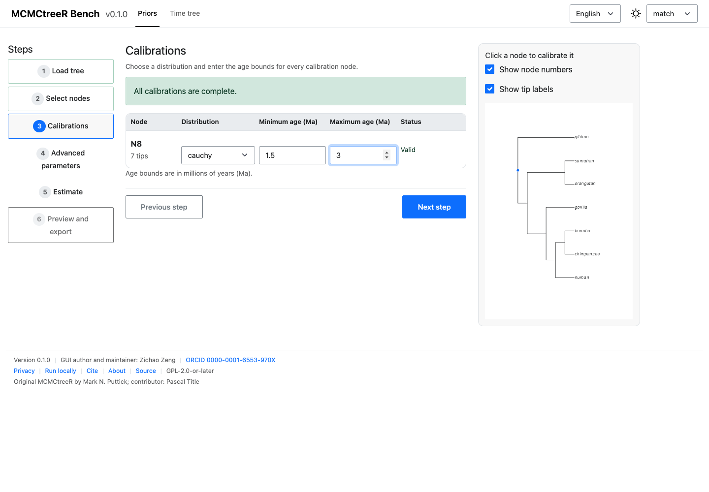 | 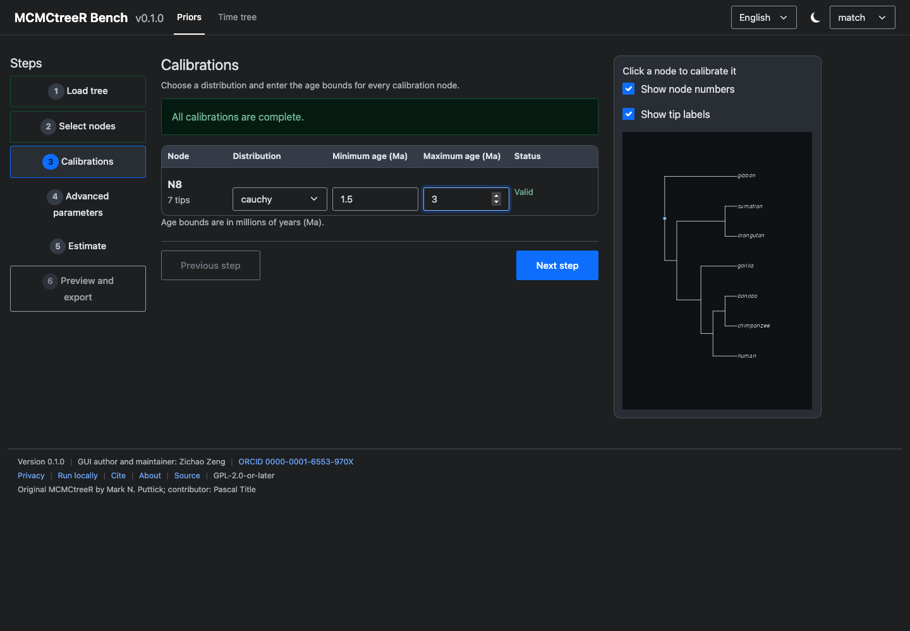 |  | 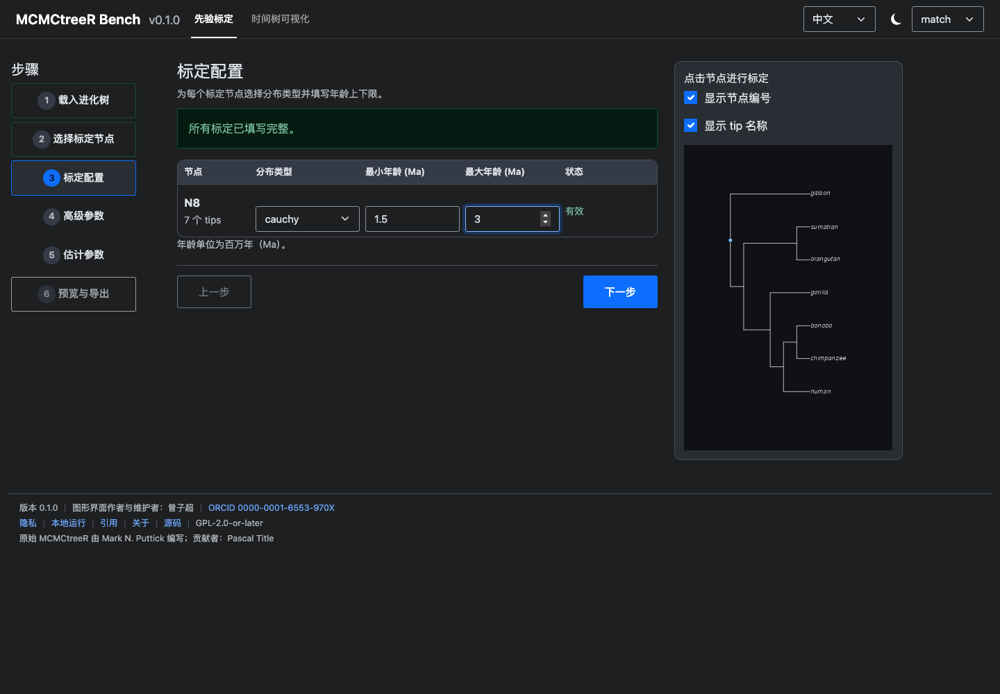 |
| 时间树 | 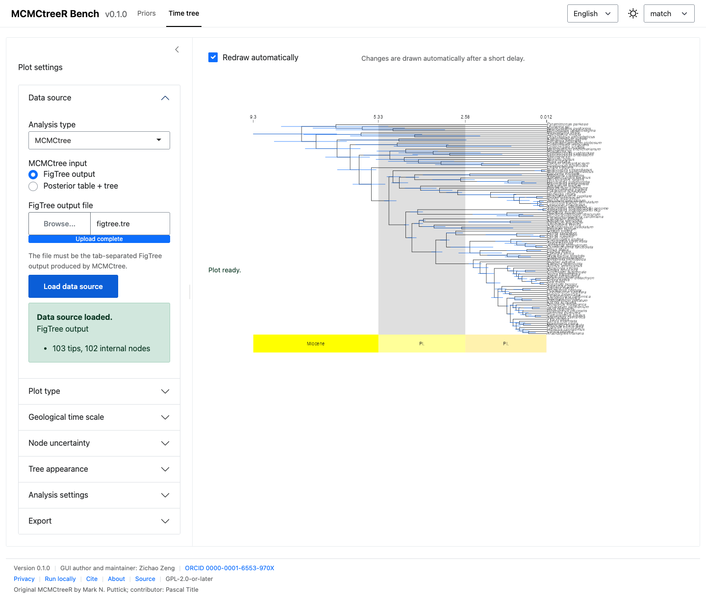 | 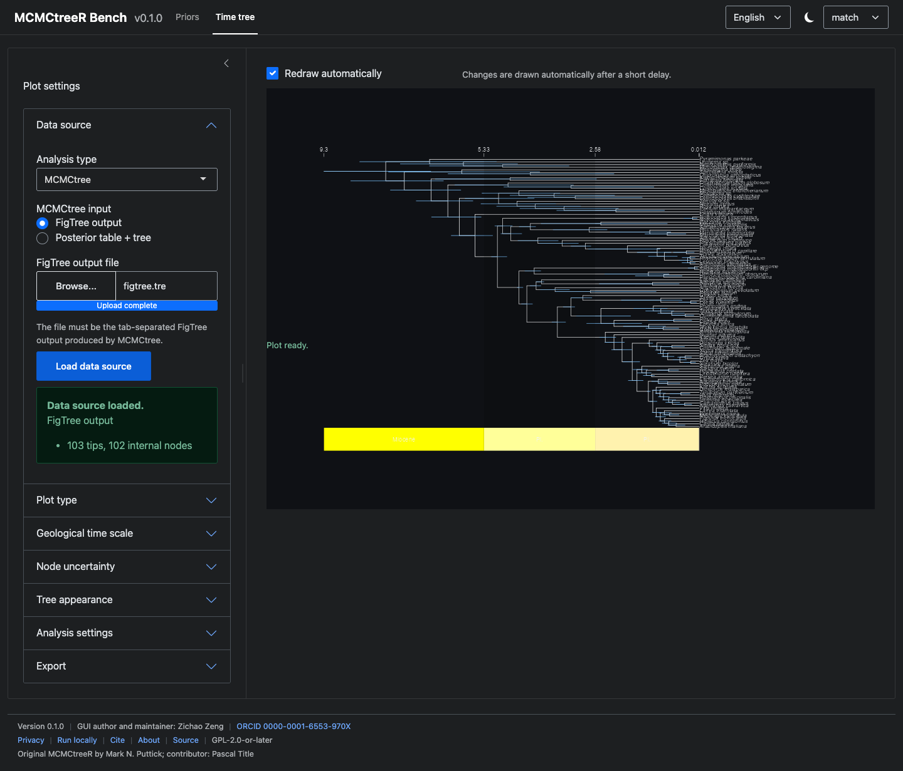 | 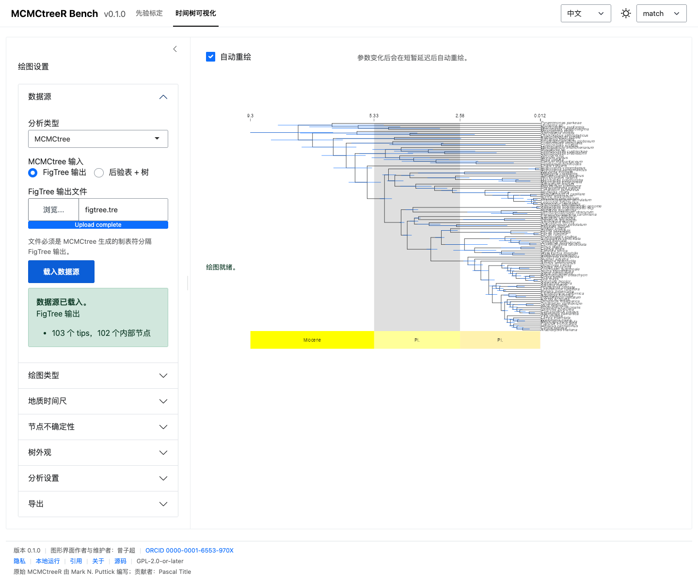 | 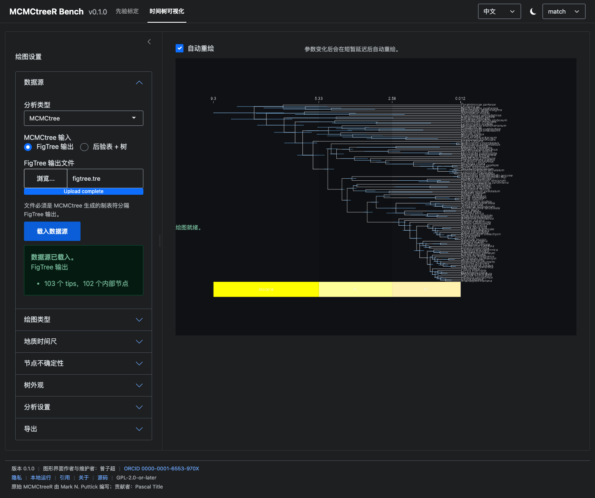 |
| 导出面板 | 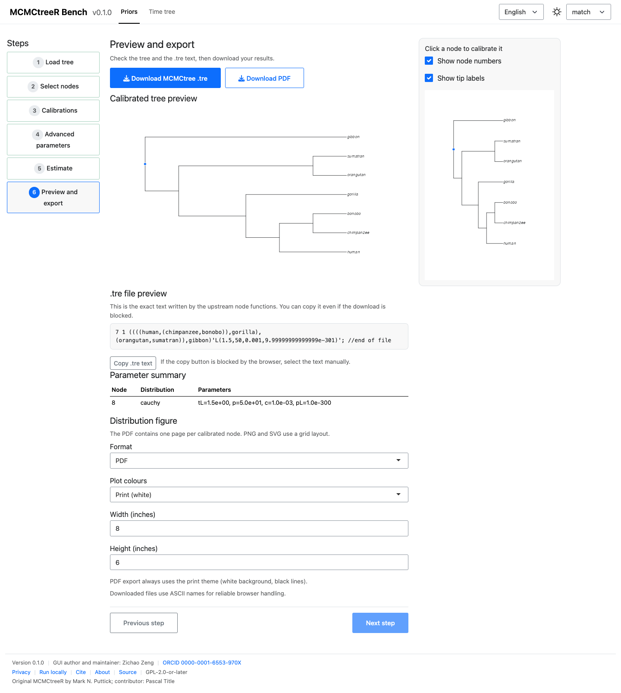 | 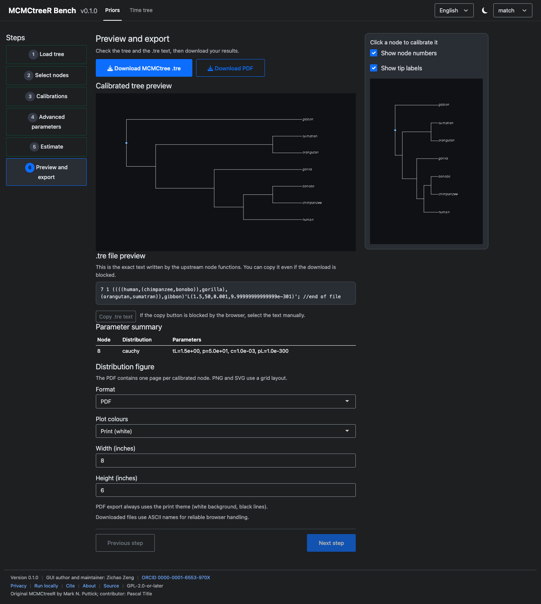 | 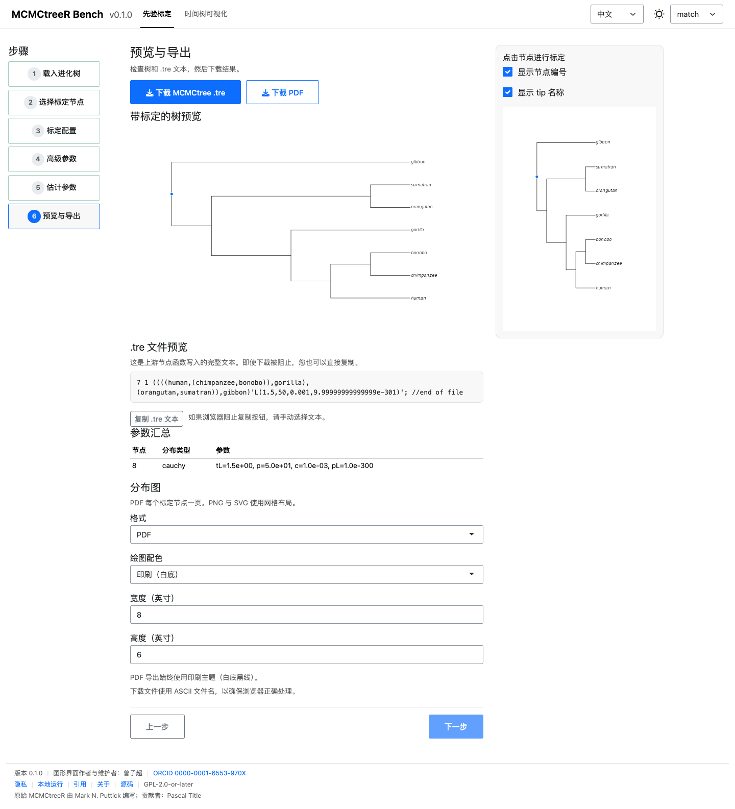 | 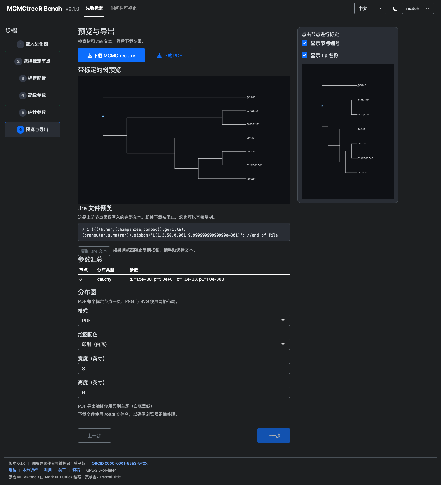 |

## 功能

- **无需写 R 代码即可准备先验。** 上传树、点击标定节点、填写化石年龄界限，
  选择 `cauchy`、`skewT`、`skewNormal`、`gamma`、`bound`、`upper` 或
  `fixed`，导出可直接用于 MCMCtree 的 `.tre` 文件。
- **核对标定范围。** 每个已选节点都会显示其后代物种，便于确认化石标定覆盖了
  目标类群。
- **可视化时间树。** 导入 MCMCtree、MrBayes、RevBayes 或 User 数据，绘制
  phylogram、cladogram 或后验分布图，并添加地质时间尺；支持 PDF、PNG、SVG
  导出。

## 快速开始（线上）

1. 打开 <https://zengzichao-mcmctreer-bench.share.connect.posit.cloud/>。
2. 在 **先验标定** 中载入内置示例或自己的树。
3. 选择内部节点，补全标定表，运行估计，下载 `.tre` 文件。
4. 在 **时间树可视化** 中载入数据源，调整绘图参数，下载图片。

请在关闭页面之前下载文件：服务器不会在会话之间保留结果。

## 本地安装

`MCMCtreeR` 已不在 CRAN。请先安装固定 commit 的上游版本，再安装本包：

```r
# 1) Upstream dependency, pinned to a reproducible commit
remotes::install_github(
  "PuttickMacroevolution/MCMCtreeR@2330e7a9916c3929513ee217d3854be993965f6b",
  build_vignettes = FALSE
)

# 2) MCMCtreeR Bench
remotes::install_github("ZengZichao/MCMCtreeR-Bench")
mcmctreer::run_app()
```

**不要**使用 `install.packages("MCMCtreeR")`：该包已从 CRAN 归档，该命令会失败。
从源码目录运行时，可使用 `devtools::load_all()`（或 `pkgload::load_all()`）
后调用 `mcmctreer::run_app()`。

## 隐私

上传文件会发送到 Posit Connect Cloud 服务器，仅写入会话专属临时目录。会话结束
或实例重启后该目录会被删除。请勿上传敏感或未发表数据；如需让数据留在本机，
请按 README 在本地运行。详见
[docs/zh/about/privacy.md](docs/zh/about/privacy.md)。

## 许可

GPL-2.0-or-later。Copyright (C) 2026 Zichao Zeng。原始 `MCMCtreeR` 包同样采用
GPL (>= 2)，版权归原作者所有。

## 作者与致谢

图形界面作者与维护者：**曾子超（Zichao Zeng）**，
<zengzichao@sjtu.edu.cn>，ORCID
[0000-0001-6553-970X](https://orcid.org/0000-0001-6553-970X)。

原始 `MCMCtreeR` 包：**Mark N. Puttick**（原包作者与维护者）；
**Pascal Title**（原 CRAN 1.1 包 contributor）。上游仓库与 commit：
<https://github.com/PuttickMacroevolution/MCMCtreeR> @
`2330e7a9916c3929513ee217d3854be993965f6b`。

MCMCtreeR Bench 是独立包装层。原包作者不对图形界面特有的错误负责。

## 如何引用

```bibtex
@software{zeng2026mcmctreergui,
  author  = {Zeng, Zichao},
  title   = {{MCMCtreeR Bench}},
  version = {0.1.0},
  year    = {2026},
  url     = {https://github.com/ZengZichao/MCMCtreeR-Bench},
  note    = {R package version 0.1.0}
}

@article{puttick2019mcmctreer,
  author  = {Puttick, Mark N.},
  title   = {{MCMCtreeR}: functions to prepare {MCMCtree} analyses and
             visualize posterior ages on trees},
  journal = {Bioinformatics},
  year    = {2019},
  volume  = {35},
  number  = {24},
  pages   = {5321--5322},
  doi     = {10.1093/bioinformatics/btz554}
}
```

## 文档

- [用户指南](docs/zh/user-guide/quickstart.md)
- [参数参考](docs/zh/reference/parameters.md)
- [本地部署](docs/zh/deployment/local.md)
- [Posit Connect Cloud 部署](docs/zh/deployment/connect-cloud.md)
- [架构](docs/zh/development/architecture.md)
- [常见问题](docs/zh/reference/faq.md)

## 支持与范围

本项目是学术工具，按“尽力维护”原则提供，不承诺 SLA。可复现的问题请提交
GitHub Issue。应用只负责准备输入与图形，不运行 MCMCtree/PAML，不判断化石年龄
的生物学合理性，也不提供账号或持久化存储。
