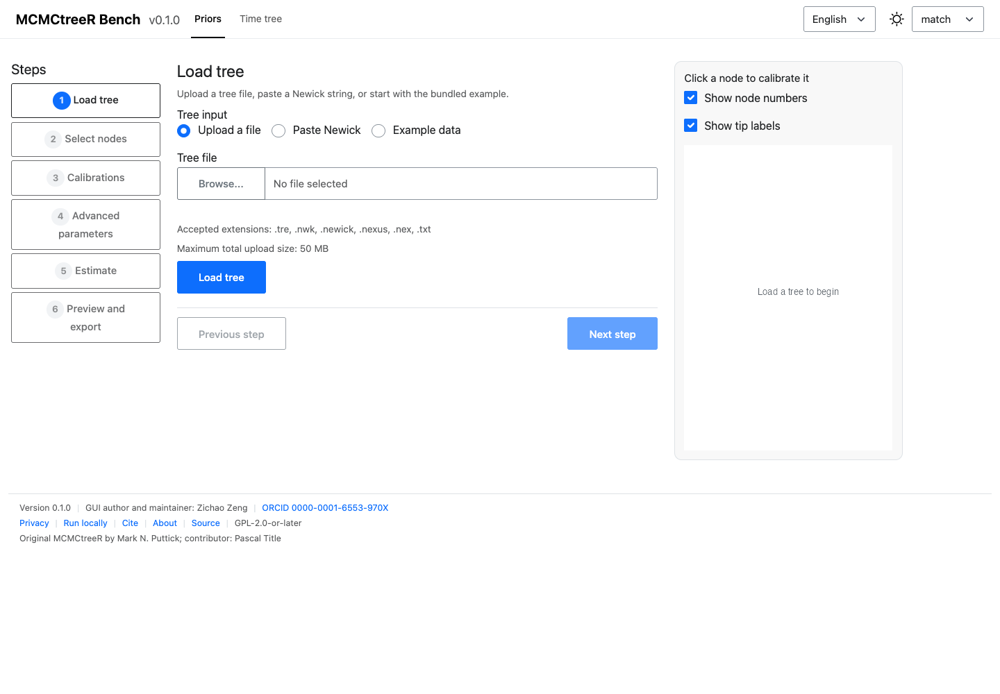
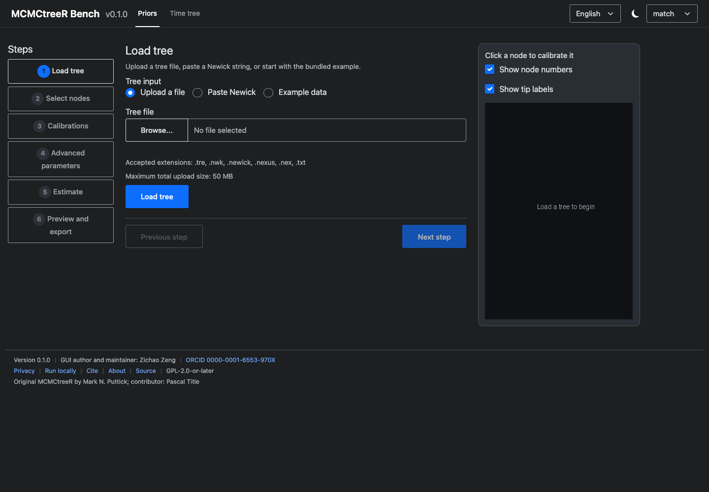

# MCMCtreeR Bench

A bilingual, light/dark-aware Shiny application for preparing MCMCtree time
priors and visualising time-calibrated phylogenies. Version **0.1.0**.

Online application (Posit Connect Cloud):
<https://zengzichao-mcmctreer-bench.share.connect.posit.cloud/>

## What this application does

The GUI wraps the original `MCMCtreeR` package without modifying it. It has two
first-class modules:

- **Priors** prepares node calibrations, estimates distribution parameters, and
  exports a MCMCtree-ready `.tre` file.
- **Time tree** draws phylograms, cladograms and posterior distribution plots
  from MCMCtree, MrBayes, RevBayes or User data.

The application does not run MCMCtree/PAML and does not judge whether fossil
ages are biologically plausible.

## Quick start

Open the online application, load the bundled example tree, select two internal
nodes, enter minimum and maximum ages, run the estimation, and download the
`.tre` file. Then switch to **Time tree** and load a time tree or posterior
table.

See [Quick start](user-guide/quickstart.md) for the full walkthrough.

## Two modules

| Module | Interaction | Output |
| --- | --- | --- |
| Priors | Six-step navigator with a persistent tree preview | `.tre` file, distribution PDF/PNG/SVG |
| Time tree | Single page with collapsible settings and live redraw | Tree PDF/PNG/SVG |

## Screenshots

| Mode | Light | Dark |
| --- | --- | --- |
| English |  |  |
| Chinese |  |  |

## Privacy and data

Uploaded files are processed in a session-specific temporary directory on the
Posit Connect Cloud server. They are deleted when the session ends or the
instance restarts. Do not upload sensitive or unpublished data; use the local
installation when data must remain on your machine.

Read [Privacy](../en/about/privacy.md) for details.

## Licence, credits and citation

MCMCtreeR Bench is GPL-2.0-or-later, copyright (C) 2026 Zichao Zeng. The original
`MCMCtreeR` package is GPL (>= 2) by Mark N. Puttick, with Pascal Title as a
contributor. See [Credits](../en/about/credits.md) and
[Citation](../en/about/citation.md).

## Version

This documentation describes version 0.1.0. The version in `DESCRIPTION` is the
single source of truth; the footer reads it at runtime.
