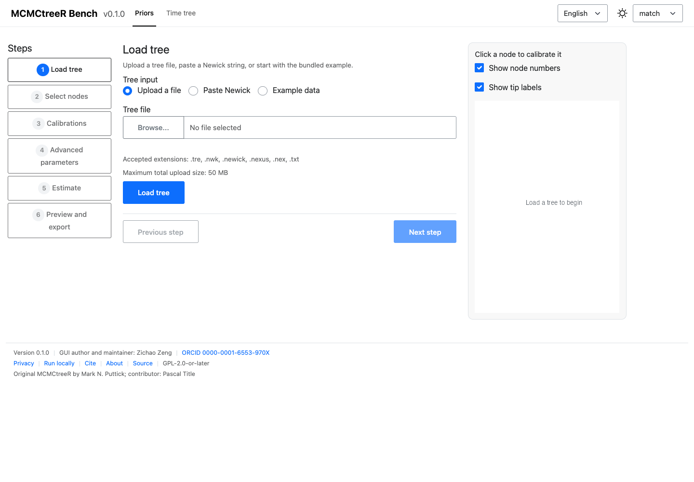
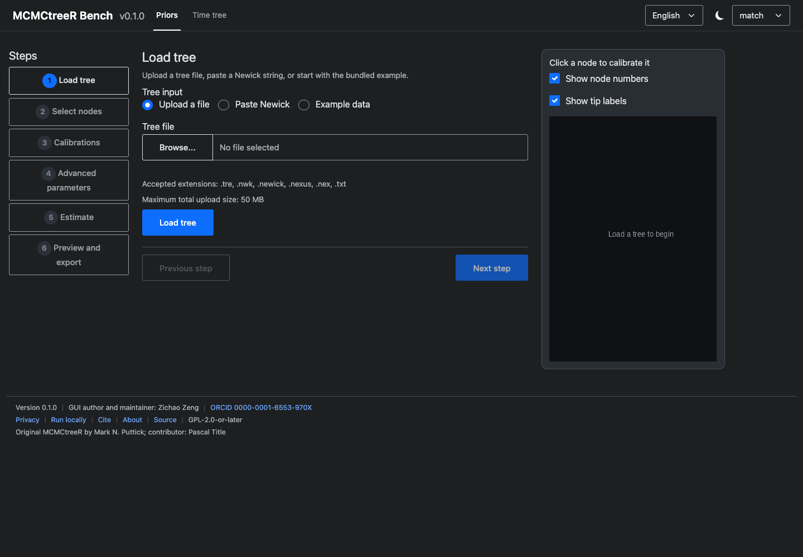

# MCMCtreeR Bench

基于 Shiny 的中英文双语、亮/暗主题应用，用于准备 MCMCtree 时间先验并可视化
时间标定系统发育树。版本 **0.1.0**。

线上应用（Posit Connect Cloud）：
<https://zengzichao-mcmctreer-bench.share.connect.posit.cloud/>

## 本应用做什么

本界面包装原始 `MCMCtreeR` 包，但不修改它。应用包含两个一级模块：

- **先验标定**：准备节点标定、估计分布参数，并导出可用于 MCMCtree 的 `.tre`
  文件。
- **时间树可视化**：从 MCMCtree、MrBayes、RevBayes 或 User 数据绘制
  phylogram、cladogram 与后验分布图。

应用不运行 MCMCtree/PAML，也不判断化石年龄在生物学上是否合理。

## 快速开始

打开线上应用，载入内置示例树，选择两个内部节点，填写最小与最大年龄，运行
估计并下载 `.tre` 文件。然后切换到 **时间树可视化**，载入时间树或后验表。

完整流程见 [快速开始](user-guide/quickstart.md)。

## 两个模块

| 模块 | 交互方式 | 产物 |
| --- | --- | --- |
| 先验标定 | 六步导航 + 常驻树预览 | `.tre` 文件、分布图 PDF/PNG/SVG |
| 时间树可视化 | 单页折叠设置 + 实时重绘 | 时间树 PDF/PNG/SVG |

## 截图

| 模式 | 亮色 | 暗色 |
| --- | --- | --- |
| English |  |  |
| 中文 |  |  |

## 隐私与数据

上传文件在 Posit Connect Cloud 服务器的会话专属临时目录中处理。会话结束或实例
重启后会被删除。请勿上传敏感或未发表数据；如需让数据留在本机，请使用本地
安装。

详情见 [隐私](../zh/about/privacy.md)。

## 许可、致谢与引用

本界面采用 GPL-2.0-or-later，版权归曾子超所有。原始 `MCMCtreeR` 包采用
GPL (>= 2)，作者为 Mark N. Puttick，Pascal Title 为 contributor。详见
[致谢](../zh/about/credits.md) 与 [引用](../zh/about/citation.md)。

## 版本

本文档对应版本 0.1.0。`DESCRIPTION` 中的版本号是唯一事实源；页脚在运行时读取
该值。
